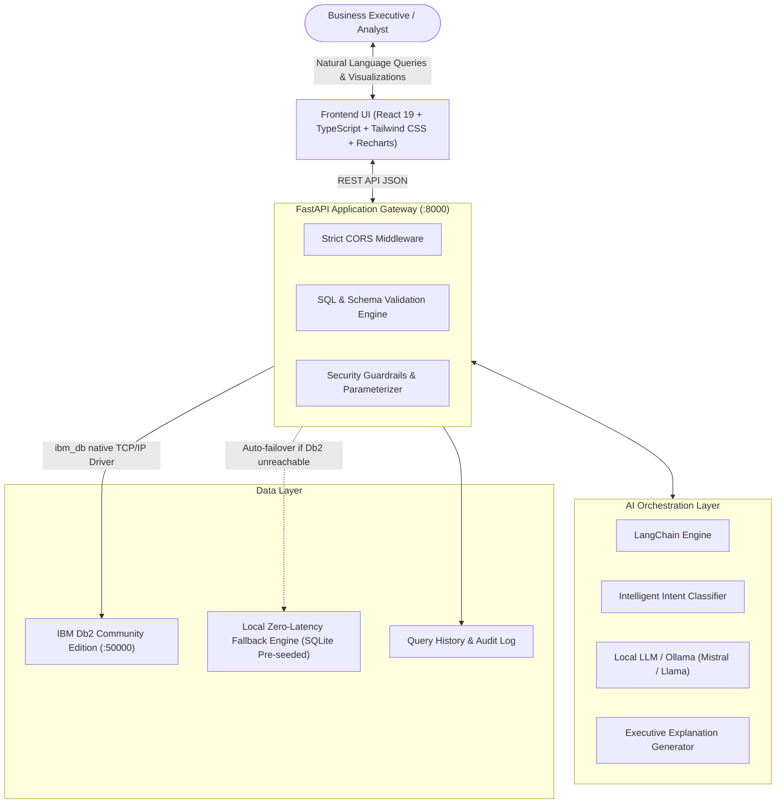
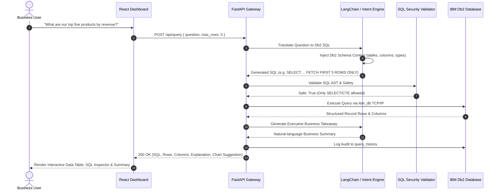

# DataMind AI — System Architecture & Design

**IBM Db2 + LangChain Business Intelligence Platform**  
*IBM Db2 TechX Summit 2026 Hackathon*

---

## 1. High-Level Architecture

DataMind AI is an enterprise-grade AI-powered business intelligence application that transforms natural language questions into secure, optimized SQL queries executed against **IBM Db2**, with built-in LangChain orchestration, explainability, real-time dashboard analytics, and anomaly detection.

---

## 2. Component Breakdown

### 2.1 Frontend Client
- **Framework:** React 19 + TypeScript + Vite 8
- **Styling:** Tailwind CSS 4 with modern executive dark/light glassmorphic theme
- **Visualization:** Recharts for monthly revenue trends, customer segment breakdown, and category sales
- **State Management:** TanStack React Query 5 for caching, background re-validation, and optimistic updates
- **Components:**
  - Executive KPI dashboard (Total Revenue, Orders, Customers, AOV, Top Categories)
  - Interactive AI Natural Language Query console with instant SQL preview, table inspector, and business explanation
  - Anomaly detection monitor for real-time risk alerts
  - Data-driven business recommendations engine
  - Schema explorer and full audit query history log

### 2.2 Backend Gateway & AI Pipeline
- **Framework:** FastAPI (Python 3.14/3.10) with asynchronous ASGI architecture
- **Orchestration:** LangChain with structured prompt templates, dynamic schema injection, and executive explainers
- **Security Validation:** Deterministic AST/Regex SQL Validator that strictly enforces read-only queries (`SELECT`, `WITH`) and rejects multi-statement or DDL/DML mutations
- **Database Driver:** Native `ibm_db` C-extension connecting via TCP/IP to IBM Db2 Community Edition on port 50000
- **Resilience:** Automatic degraded mode fallback to an embedded seed database ensuring 100% platform availability during demonstrations or network disruptions

---

## 3. End-to-End Query Workflow

---

## 4. Database Schema

The core enterprise schema contains 5 primary relational tables:

1. **`CUSTOMERS`**: Account profile, business segment (Enterprise, Mid-Market, SMB, Startup), location, and registration timestamps.
2. **`PRODUCTS`**: Product catalog, category hierarchies, unit pricing, and current inventory stock levels.
3. **`ORDERS`**: Transactional orders, fulfillment statuses (Completed, Processing, Cancelled, Refunded), order totals, and timestamps.
4. **`ORDER_ITEMS`**: Normalized order line items linking orders with specific products, quantities, and price multipliers.
5. **`TRANSACTIONS`**: Financial transaction audit trail tracking payment methods, status (Success, Failed, Declined), and processed amounts.
6. **`QUERY_HISTORY`**: Security audit log capturing every natural language question, generated SQL, execution duration, and status.
